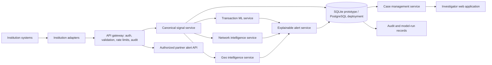

# ScamTrace AI — Product Requirements and Technical Specification

**Status:** Product and implementation specification for the prototype  
**Audience:** Product, engineering, data science, security, and investigation stakeholders  
**Last updated:** 2026-11-05

## 1. Product requirements

### 1.1 Vision

ScamTrace AI is a modular financial-intelligence layer for authorized financial institutions, regulators, and investigation teams. It accepts authorized, minimized transaction signals; analyzes transaction-level, network, and (where independently supplied) geographic patterns; and gives authorized human reviewers explainable leads.

ScamTrace complements existing monitoring and investigation systems. It does not replace an institution's source-of-record systems, determine that a person committed fraud, make payment decisions, freeze accounts, or contact institutions without an approved integration.

### 1.2 Problem and users

Fraud and laundering activity can cross accounts, institutions, channels, and locations. A single institution may see only part of a movement of funds. A governed intelligence layer can help reviewers connect permitted signals while institutions retain their source records and control their own operational decisions.

| User | Primary need |
|---|---|
| Authorized investigator / analyst | Review explainable alerts, trace connected activity, record findings, and manage cases |
| Investigation supervisor | Assign and prioritize cases, monitor status, and review investigator decisions |
| Participating institution integration operator | Submit permitted signals, receive authorized alert responses, and inspect integration health |
| Platform administrator / auditor | Manage access and configuration and review protected audit records |
| Data scientist / model operator | Train, compare, approve, version, and monitor models without exposing labels to operational users |

### 1.3 Product principles and boundaries

1. Process only signals authorized for the purpose, with data minimization and institution-specific governance.
2. Keep the ULB transaction-classification track separate from the AMLSim graph track. Do not fabricate joins between them.
3. Use synthetic, clearly labelled data for demonstrations. Do not represent synthetic institutions, accounts, cases, or locations as real.
4. An alert is a review lead, not a verified fraud finding. Show its matched evidence and limitations.
5. Keep a human investigator responsible for all investigation decisions. Never automatically block, freeze, or execute a payment.
6. Avoid direct identifiers unless legally necessary and explicitly approved. The initial prototype uses pseudonymous identifiers and fictional data.
7. Treat models and heuristic rules as versioned decision-support components, with measurable offline evaluation and operational oversight.
8. Do not claim production readiness, compliance, external integrations, or validated performance until independently established.

### 1.4 Functional requirements

| ID | Requirement | MVP acceptance |
|---|---|---|
| FR-01 | Receive and validate minimized transaction signals | Reject malformed or unauthorized requests with a structured error; record accepted signals with source and ingestion time |
| FR-02 | Produce transaction-level fraud indicators | Score validated inputs using a versioned model or explicit baseline; return score, model version, and limitations |
| FR-03 | Build directed transaction networks | Represent source-to-destination transfers and support bounded, timestamp-aware multi-hop tracing |
| FR-04 | Detect explainable network patterns | Identify configured patterns such as rapid pass-through, multiple outgoing transfers, and cross-institution activity; return the matched facts |
| FR-05 | Support geographic review | Display only separately supplied, provenance-labelled locations; calculate distance only when coordinates and timestamps are available |
| FR-06 | Explain every alert | Include risk indicator, signal references, relevant relationships, available geographic indicators, timeline, explanation, and data provenance |
| FR-07 | Manage investigations | Create, assign, update, and close cases; add evidence references and append-only timeline events; record human decisions |
| FR-08 | Integrate with partner systems | Provide versioned authenticated REST endpoints and institution-specific adapters; isolate partner formats from the canonical signal schema |
| FR-09 | Enforce authorization and auditability | Apply role and institution scope to reads and writes; audit sensitive actions and administrative changes |
| FR-10 | Export a case summary | Export authorized case data and provenance in a reviewable format, with access logged |
| FR-11 | Evaluate model versions | Store reproducible dataset, split, preprocessing, model, and metric metadata; never display fabricated scores |
| FR-12 | Preserve demonstration transparency | Label all existing fictional demo data and all future generated AMLSim/geographic data as synthetic |

### 1.5 Non-functional requirements

- **Security:** deny by default; authenticated, scoped access; TLS in deployment; secrets outside source control; encrypted storage and backups where supported.
- **Privacy:** purpose limitation, data minimization, configurable retention, no re-identification, and no sensitive data in routine logs.
- **Reliability:** validate at system boundaries, use idempotent ingestion identifiers, handle duplicate submissions explicitly, and surface failures.
- **Explainability:** persist the feature/rule evidence and component versions that produced each alert; preserve the distinction between score and decision.
- **Performance:** bound trace depth, result count, request size, and time windows; define service-level targets only after representative load testing.
- **Portability:** SQLite for local prototype; keep data access and migrations portable to PostgreSQL for governed deployment.
- **Accessibility and usability:** clear status, provenance, uncertainty, keyboard-operable controls, and investigator-oriented filtering.
- **Maintainability:** separate API, domain services, adapters, model lifecycle, graph analysis, geo analysis, and presentation.

### 1.6 Out of scope for the initial MVP

Real-time bank connectivity, production credentials, real customer GPS, automated payment controls, automated account freezes, autonomous investigation decisions, identity resolution across institutions, and claims of regulatory compliance are out of scope. Each would require separate authorization, threat modeling, governance, and operational approval.

## 2. System architecture

### 2.1 Target architecture



Services are logical boundaries for the MVP; they do not require separate deployable microservices. Start with a modular monolith and extract services only when deployment, isolation, or scale needs justify it.

### 2.2 Technology direction

| Layer | Direction |
|---|---|
| Existing demonstrator | Python, Streamlit, Pandas, NetworkX, Plotly; fictional preloaded signals |
| API-backed MVP | Python, FastAPI, Pydantic; OpenAPI REST endpoints; SQLite; scoped API-key roles; signal, alert, case, and audit workflows |
| Web UI MVP | React, TypeScript, Vite, Tailwind CSS, Recharts, Lucide; signal, alert, case, network, geography, model-run, and audit views |
| Analysis | Pandas, NetworkX, scikit-learn, Joblib; training requires an explicit local run |
| Deployment direction | SQLite for local prototype; PostgreSQL-compatible schema for governed deployment |

The Streamlit demo remains available as a fallback. The web and API MVP uses a deliberately insecure local development key and is not production-ready; production deployment requires managed identity, production secrets, hardened authorization, deployment review, and operational controls.

### 2.3 Proposed module boundaries

```text
scamtrace/
  api/                 FastAPI routes, dependencies, request/response schemas
  auth/                API token verification, roles, institution scope
  domain/              Canonical signal, alert, and case rules
  adapters/            Partner-specific mapping and validation
  intelligence/
    transaction_ml/    Preprocessing, training, evaluation, inference
    network/            Directed graph construction and indicators
    geo/                Coordinate provenance, distance, aggregation
    explainability/     Evidence assembly and human-readable reasons
  cases/                Case lifecycle, assignments, timeline, exports
  persistence/          Repositories, migrations, database configuration
  audit/                Append-only security and activity events
scripts/                Dataset fetch, training, evaluation, maintenance
models/                 Versioned local artifacts; exclude from source control as appropriate
data/
  raw/                  Downloaded benchmark data; not committed
  processed/            Reproducible derived data; not committed by default
```

Implementation should preserve the existing Streamlit demo while extracting reusable analysis logic. A staged UI migration can consume the same domain services and API contracts; replacing the app wholesale is not required for the first working MVP.

## 3. Feature breakdown

| Engine | MVP behavior | Later capability |
|---|---|---|
| Signal ingestion and connectors | Canonical Pydantic schema, CSV/demo adapter, authenticated ingestion endpoint, idempotency | Institution-specific API adapters, delivery retries, partner health dashboard |
| Transaction ML | Train and compare Logistic Regression and Random Forest on ULB; report measured evaluation | Approved model registry, drift monitoring, calibrated thresholds and governed retraining |
| Network intelligence | Directed NetworkX graph, bounded path trace, components, rapid pass-through and explainable indicators on synthetic AMLSim/demo data | Larger graph storage/processing, temporal motifs, benchmarked cluster methods |
| Geo intelligence | Map and distance indicators only for explicitly synthetic or separately authorized coordinate data | Geospatial aggregation, configurable movement baselines, operational location feeds if approved |
| Explainability | Evidence-backed alert card with source, time, linked signals, reasons, score meaning, and provenance | Investigator feedback loops and explanation quality evaluation |
| Investigation management | Persistent cases, status, assignee, notes/evidence references, event timeline, export | Work queues, service-level workflow, redaction and retention controls |
| Web application | Preserve Streamlit and provide a React/TypeScript API-backed dashboard | Expand reporting, access-controlled investigator details, and production usability after further validation |
| Governance and operations | Roles, institution scoping, audit events, versioned evaluation records | Central identity provider, key rotation workflows, monitoring, deployment controls |

### Alert content contract

Each alert must contain: alert ID and creation time; indicator and score scale; score interpretation and threshold/model/rule version; matched signal IDs and provenance; relevant directed relationships and bounded trace; event timeline; available geographic indicator with source and synthetic/real status; plain-language reasons; known limitations; and review status. Omit a geographic field when no valid, authorized location signal exists—never infer GPS from ULB features.

## 4. Database schema

Use migrations and foreign keys. Store source event time separately from ingestion time and normalize timestamps to UTC. The following is the logical SQLite-first schema; use equivalent PostgreSQL types in deployment.

| Table | Important fields and constraints |
|---|---|
| `institutions` | `id` PK, `name`, `status`, `created_at`; demo names must be marked synthetic |
| `api_clients` | `id` PK, `institution_id` FK, `key_hash` unique, `role`, `scopes`, `created_at`, `expires_at`, `revoked_at`; never store the raw key |
| `transaction_signals` | `id` PK, `institution_id` FK, `external_signal_id`, `source_account_ref`, `destination_account_ref`, `amount`, `currency`, `channel`, `occurred_at`, `ingested_at`, `provenance`, `synthetic`; unique `(institution_id, external_signal_id)` for idempotency |
| `geo_observations` | `id` PK, `signal_id` FK, `latitude`, `longitude`, `precision_m`, `source`, `synthetic`, `observed_at`; no location inferred from transaction benchmark data |
| `alerts` | `id` PK, `indicator_type`, `score`, `score_scale`, `status`, `created_at`, `model_version`, `rule_version`, `provenance`, `explanation_json` |
| `alert_signals` | `alert_id` FK, `signal_id` FK, `relationship`/evidence reason; composite key prevents duplicate evidence links |
| `cases` | `id` PK, `title`, `status`, `priority`, `created_by`, `assignee_id`, `created_at`, `updated_at`, `closed_at` |
| `case_alerts` | `case_id` FK, `alert_id` FK, linked time; composite primary key |
| `case_events` | `id` PK, `case_id` FK, `actor_id`, `event_type`, `body`, `created_at`; append-only investigator timeline |
| `evidence_refs` | `id` PK, `case_id` FK, `added_by`, `evidence_type`, `uri_or_signal_id`, `description`, `created_at`; restrict external references and access |
| `users` | `id` PK, external identity subject, display name, status; do not store passwords when using an identity provider |
| `model_runs` | `id` PK, dataset/source/version, split metadata, preprocessing version, model type, artifact URI/hash, metrics JSON, created time, approval status |
| `audit_events` | `id` PK, actor/client, institution scope, action, resource type/ID, outcome, timestamp, request correlation ID; exclude secrets and unnecessary sensitive payloads |

Indexes should cover institution plus event time, source/destination references within permitted scope, alert status/time, case assignee/status, and event case/time. Apply database-level constraints where possible. Do not use globally meaningful account identifiers in cross-institution views; the institution adapter must apply an approved pseudonymization and linkage policy. A pseudonym is still sensitive data.

## 5. API architecture

### 5.1 Conventions and authorization

- Prefix endpoints with `/api/v1`; publish OpenAPI and use Pydantic schemas for validation.
- Use HTTPS in any deployment. Authenticate machine clients with revocable, rotated API tokens; store only a strong hash of each token. Prefer a managed identity provider/OAuth2 for interactive users.
- Enforce role-based authorization plus institution/resource scope on every read and write. Suggested roles: `integration_client`, `investigator`, `supervisor`, `auditor`, and `administrator`.
- Return consistent JSON errors (`code`, safe `message`, `request_id`, optional field errors); do not expose stack traces or other institutions' records.
- Apply request-size limits, rate limits, timestamps, currency/amount validation, bounded pagination, and idempotency keys. Do not silently discard invalid or duplicate data.
- Audit authentication outcomes, ingestion, alert access, case changes, exports, and privileged configuration changes.

### 5.2 Initial endpoint set

| Method and path | Purpose | Minimum authorization |
|---|---|---|
| `POST /api/v1/signals` | Validate and ingest one or a bounded batch of canonical signals | `integration_client`, scoped to institution |
| `GET /api/v1/signals/{signal_id}` | Retrieve a permitted signal/provenance record | scoped investigator or integration client |
| `POST /api/v1/transaction-assessments` | Score a validated feature vector against an explicitly selected, approved model version | authorized investigator or integration client |
| `GET /api/v1/alerts` | Filter and page authorized alerts | investigator, supervisor, auditor |
| `GET /api/v1/alerts/{alert_id}` | Retrieve alert explanation and evidence references | investigator, supervisor, auditor |
| `GET /api/v1/geo/indicators` | Retrieve permitted geographic indicators with provenance and synthetic status | investigator, supervisor |
| `POST /api/v1/alerts/{alert_id}/cases` | Create or link an investigation case | investigator, supervisor |
| `GET /api/v1/cases` / `GET /api/v1/cases/{case_id}` | List/retrieve authorized case work | investigator, supervisor |
| `POST /api/v1/cases` | Create a case | investigator, supervisor |
| `PATCH /api/v1/cases/{case_id}` | Update permitted status/assignment fields | investigator, supervisor |
| `POST /api/v1/cases/{case_id}/events` | Append a note or decision to the timeline | investigator, supervisor |
| `POST /api/v1/cases/{case_id}/evidence` | Attach a reference or approved evidence metadata | investigator, supervisor |
| `GET /api/v1/cases/{case_id}/export` | Export an authorized investigation summary | investigator, supervisor; audit required |
| `GET /api/v1/health` | Liveness/readiness without sensitive environment details | public or deployment-restricted |

The API returns an intelligence signal and supporting evidence. It does not return a command to approve, reject, hold, or freeze a payment.

The assessment endpoint accepts only the feature schema declared by the requested model version. The ULB-trained benchmark model expects anonymized card features; it must not be applied to arbitrary canonical account-transfer signals or presented as a validated partner-transaction model. Any operational scoring use requires a compatible, authorized dataset and separate validation.

### 5.3 Canonical signal example

```json
{
  "external_signal_id": "partner-opaque-id",
  "occurred_at": "2026-11-05T08:30:00Z",
  "source_account_ref": "approved-pseudonym-1",
  "destination_account_ref": "approved-pseudonym-2",
  "amount": "1250.00",
  "currency": "INR",
  "channel": "instant_transfer",
  "provenance": {
    "adapter": "example-institution-v1",
    "schema_version": "1.0"
  }
}
```

Do not include names, account numbers, card numbers, credentials, or coordinates by default. A connector maps partner-specific payloads to this canonical form, validates source authority and field semantics, and preserves source provenance. Separate API schemas and access policies apply if an approved use case requires additional fields.

## 6. Dataset integration strategy

Maintain distinct data tracks, storage paths, reports, and user-facing labels:

### Track A — ULB / Worldline transaction classification

- Use the ULB / Worldline credit card benchmark accessed via OpenML dataset 1597. The source is real, anonymized card activity; it is not a cross-bank account-transfer graph.
- Available data includes PCA-transformed `V1`–`V28`, `Amount`, elapsed `Time`, and binary `Class` label. It has no real customer GPS, bank identity, or account-edge information.
- The repository includes `scripts/fetch_ulb.py` and a locally present `data/raw/ulb_creditcard.csv`; raw data is excluded from version control. Re-check source terms before redistribution and credit the ULB Machine Learning Group and Worldline.
- Use only for offline model development and evaluation. Do not expose `Class` as an inference feature or operational user field.

### Track B — IBM AMLSim network analysis

- Use IBM AMLSim generated banking networks to exercise account graph construction, multi-hop tracing, and laundering typologies.
- Treat accounts, banks, transactions, and labels as synthetic simulation data. Label every UI, chart, case, and metric accordingly.
- Record AMLSim version/configuration, generation parameters, random seed where available, and typology labels in each experiment.
- Keep graph metrics/results separate from ULB transaction benchmark metrics. Do not join the datasets or claim graph evaluation on ULB.

### Geographic demonstration data

- ULB does not contain GPS or identifiable bank locations. Do not geocode or infer actual people/locations from anonymized columns.
- For a map demonstration, add a separate, explicitly synthetic location fixture with documented generation method and `synthetic=true`; label it in the UI and exports.
- For any future authorized location feed, require purpose/legal approval, field-level provenance, coordinate precision controls, retention limits, and an explicit data quality check. Never fill missing coordinates with invented locations.

### Future partner data

Before onboarding a real institution, require written authority and a data-sharing agreement defining permitted purposes, fields, retention, jurisdictions, security controls, incident handling, and deletion. Validate each partner's schema through an adapter and use institution-scoped pseudonyms. Do not create cross-institution identity links unless expressly authorized and governed.

### Data quality and reproducibility

Validate schema, target values, nulls, numeric ranges, duplicate identifiers, timestamps, currencies, and row counts. Preserve raw downloaded files unchanged and store derived datasets separately. Record dataset provenance, acquisition date, checksum, preprocessing code/version, split boundaries, random seeds, dependency versions, and model artifact hash for each run.

## 7. ML training and inference pipeline

### 7.1 Training flow

1. **Acquire and verify:** load the local ULB file or fetch through the existing script; verify expected target and features, row count, class count, and source metadata. Fail visibly on schema mismatch.
2. **Separate target:** use `Class` only as the label. Retain feature names and dataset provenance.
3. **Split before fitting preprocessing:** preserve time ordering where `Time` is present. If the source omits time, use a reproducible, stratified 70/15/15 train/validation/test split and explicitly record that it is not chronological. Define boundaries before model selection and report class counts for each split.
4. **Build baselines:** compare Logistic Regression and Random Forest against a transparent, non-learning baseline. Consider Isolation Forest only as a separate unsupervised anomaly-ranking baseline.
5. **Handle imbalance:** start with class weighting (`class_weight="balanced"` where supported) and threshold selection on validation data. If oversampling is investigated, apply it only within training folds and document it; never oversample validation or test data. Do not optimize accuracy.
6. **Preprocess within a fitted pipeline:** standardize numeric features for Logistic Regression; compare feature handling for Random Forest without unnecessary scaling. Fit imputers/scalers only on training data. Add a `log1p` Amount transform only after validating non-negative values and record the transform.
7. **Select and evaluate:** choose thresholds using validation data and an explicit investigator review capacity. Evaluate once on the untouched holdout. Save confusion matrix counts and class-specific precision, recall, F1, precision-recall curve/Average Precision (clearly labelled), and precision/recall at top K. Include uncertainty and split limitations.
8. **Compare fairly:** use the same fixed data split and preprocessing discipline for supervised model comparisons. Compare Isolation Forest separately as an anomaly score, not as though it were a supervised classifier.
9. **Serialize:** persist a versioned scikit-learn pipeline with Joblib plus a metadata manifest containing feature schema/order, dataset version/hash, split, configuration, metrics, Python/library versions, training time, and artifact checksum. Load only trusted, access-controlled artifacts; Joblib files must not be accepted from untrusted sources.
10. **Approve and serve:** only an explicitly reviewed model version can serve inference. Validate the incoming feature schema, reject missing/extra or invalid fields as defined by the contract, return model version and decision-support score, and log the request metadata without raw sensitive payloads.

### 7.2 Required evaluation report

Report sample counts and fraud prevalence for every split; confusion matrix with threshold; precision, recall, F1, and Average Precision (PR-AUC terminology must specify which computation); precision/recall at review capacity; threshold selection method; model comparison; and limitations. Accuracy alone is inadequate for a highly imbalanced dataset. Never publish placeholder or fabricated values: populate results only from an executed, reproducible training run.

### 7.3 Inference response

Return an opaque prediction ID, numeric risk indicator and documented scale, model/version, timestamp, validated input reference, and explanation/feature evidence appropriate to the model. Distinguish model score from a calibrated probability; do not call it a probability unless calibration is measured and documented. No response should be framed as a fraud determination or payment instruction.

## 8. Security, privacy, and governance

- **Authority and purpose:** complete legal, privacy, and institutional approval before processing real partner data. Define permitted users, use cases, data fields, retention, disclosure, and incident responsibilities.
- **Least privilege:** use scoped roles, institution boundaries, short-lived/revocable credentials where feasible, administrative separation, and periodic access review. Test cross-tenant access denial.
- **Secrets and transport:** never commit credentials; use a secrets manager/environment injection, rotate/revoke tokens, and require TLS outside local development.
- **Data protection:** minimize fields; pseudonymize at the partner boundary; encrypt storage, backups, and exports in deployment; control export access; set deletion and retention policies. Pseudonymous records remain sensitive.
- **Input and API safety:** schema validation, bounded payloads and graph queries, rate limits, safe errors, request IDs, duplicate/idempotency handling, and dependency updates.
- **Audit:** record actor, scoped institution, action, resource, time, outcome, and correlation ID for sensitive access and changes. Protect audit records from unauthorized modification and avoid logging API tokens, raw account data, or unnecessary payloads.
- **Model governance:** version datasets, code, artifacts, and thresholds; restrict artifact write access; review performance and drift; document known limitations and approval status; provide a path to disable a model.
- **Human oversight:** make evidence, provenance, and uncertainty visible; capture investigator decisions as human-entered records; prohibit automatic freezing/payment execution.
- **Synthetic-data labeling:** carry `synthetic` and provenance metadata through APIs, UI, case exports, charts, and metrics. Do not mix synthetic and real results in a single unlabeled statistic.
- **Threat review:** assess unauthorized access, cross-institution leakage, credential theft, malicious payloads, re-identification, data poisoning, model artifact tampering, insider misuse, and denial-of-service before deployment.
- **Prototype caveat:** the existing local Streamlit app is a demonstration, not a secured multi-user service. It has no implemented API authentication, RBAC, audit store, or case database.

## 9. Development roadmap

| Phase | Deliverables | Exit criteria |
|---|---|---|
| 0. Baseline and contracts | Preserve current Streamlit demo; define canonical signal, alert, case, provenance, and role contracts; document dataset cards | Existing synthetic demo still runs; contracts explicitly distinguish real ULB benchmark from synthetic graph fixtures |
| 1. Reproducible ML baseline | Training/evaluation script and tests for Logistic Regression and Random Forest; optional separately reported Isolation Forest; Joblib artifact and metadata | Actual run produces complete metrics and confusion matrix on a held-out split; no fabricated results; artifact reload test passes |
| 2. Modular analysis and persistence | Extract graph and rule logic; SQLite schema/migrations; store signals, alerts, model runs, and cases | Repeatable local workflow, validated persistence, bounded tracing, and evidence-linked alerts |
| 3. Authenticated API | FastAPI/Pydantic, API token verification, role and institution authorization, ingestion/alert/case routes, audit events | Authenticated integration tests cover valid/invalid input, duplicate requests, role denials, institution isolation, and audit records |
| 4. Investigation and geo demonstration | Case assignment/status/timeline/evidence/export; clearly synthetic geographic fixture and map | Case lifecycle is persistent; every geo visualization shows provenance and synthetic status; no location inferred from ULB |
| 5. UI integration | Keep Streamlit demo as a reference/first client; implement React/TypeScript frontend against stable API where justified | Investigator flows work end-to-end; accessibility, API error, and provenance states are tested |
| 6. Deployment readiness | PostgreSQL migrations, managed identity/secrets, TLS, monitoring, backup/restore, retention, security review, partner onboarding | Approved threat model, operational runbooks, penetration/security tests, governance approvals, and load-tested service objectives |

Each phase should have a demo using fictional or otherwise approved data. Production deployment is a separate gate, not the automatic outcome of an MVP milestone.

## 10. MVP implementation priorities

### P0 — Demonstrable, honest MVP

1. Keep the existing Streamlit command center, network trace, triage illustration, and signal ledger working with its explicitly fictional signals.
2. Add modular, testable analysis functions and tests for the existing directed-graph indicators and evidence explanations.
3. Implement an offline ULB training/evaluation script with leakage-conscious split, class-imbalance handling, model comparison, required metrics, and no hard-coded performance claims.
4. Save versioned model artifacts and metadata locally; keep raw datasets and generated artifacts out of version control.
5. Establish the canonical signal/alert schemas and SQLite persistence for signals, alerts, model runs, and cases before building operational workflows.
6. Add a basic persistent case workflow with human-entered status, assignment, timeline, and summary export.
7. Add authenticated FastAPI endpoints only after schema and persistence foundations; test RBAC and institution isolation before exposing them.

### P1 — Required for an integration-ready demonstration

Add a partner adapter example, idempotent batch ingestion, alert lookup, audit events, synthetic geographic fixture, provenance-aware map and distance indicators, and frontend/API integration tests. Label simulated adapters and generated metadata at every output.

### P2 — Governed deployment

PostgreSQL, external identity management, key rotation, encrypted backups, retention automation, monitoring, deployment hardening, operational support, partner agreements, and independent security/privacy review.

### MVP “done” checklist

- [ ] Current demo remains runnable and identifies its signals as fictional.
- [ ] ULB evaluation is actually executed; metrics and model artifact are reproducible and never invented.
- [ ] AMLSim graph experiments are separately labelled synthetic and are not joined to ULB.
- [ ] Geo indicators appear only when coordinate provenance is present and are explicitly synthetic or approved.
- [ ] Alerts contain evidence, provenance, timeline, explanation, model/rule version, and score caveat.
- [ ] Cases persist and capture human review actions.
- [ ] API authentication, role checks, institution scoping, validation, idempotency, and audit logging pass tests before integration use.
- [ ] No automated payment or account-control behavior is present.
- [ ] Documentation and UI do not imply real bank integrations or production security that have not been implemented.